# Build a 3D NUS Campus Digital Twin & Live Transit Tracker with Spec-Driven Development in Google Antigravity

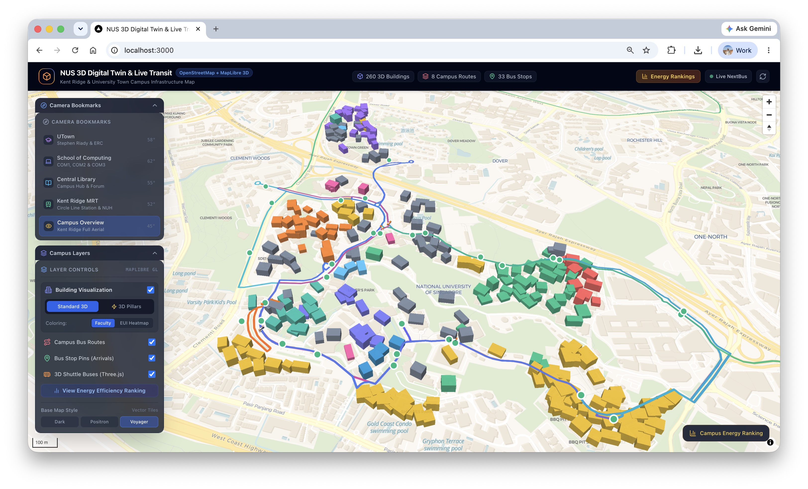

## Overview & Objectives
Duration: 0:04:00

In this codelab, you will build a state-of-the-art **3D NUS Campus Digital Twin & Real-Time Transit Tracker** — an interactive geospatial command center combining:
1. **Interactive 3D Campus Canvas**: A high-performance WebGL digital twin rendered with **MapLibre GL JS** and **OpenStreetMap**, featuring dynamic 3D building extrusions, pitched camera controls, and smooth landmark fly-to transitions across Kent Ridge campus.
2. **Real-Time Campus Transit Tracking**: Live shuttle bus telemetry powered by the dedicated **GCP Cloud Run Transit Proxy** (`https://nus-transit-cache-429047621215.asia-southeast1.run.app`), delivering authentic stop coordinates, canonical route polylines, and real-time **estimated** vehicle positions derived from per-stop arrival countdowns with per-segment error bounds (`errorBoundM`). Learn how real-world tracking operates without fake simulations, handling scheduled operations and off-service status cleanly.
3. **3D Energy Pillars & Campus Energy Efficiency Analytics**: Vertical 3D extrusions rising from campus buildings with heights proportional to Energy Use Intensity (EUI), color-coded Green/Yellow/Red, paired with an interactive **Campus Energy Efficiency Bar Chart** that ranks campus facilities and flies the 3D camera to any selected building, alongside a detailed click-to-inspect Energy HUD pulling from the official **NUS Digital Twin API**.
4. **Cloud-Native Serverless Deployment**: Production deployment on **Vercel** with Next.js App Router serverless route handlers, secured API proxy caching, and worldwide edge CDN delivery.

---

### System Architecture & Data Pipeline
This diagram illustrates how your Next.js application ingests university telemetry, processes geospatial features, and renders the 3D twin:

```
                      ┌────────────────────────────────────────────────────────┐
                      │              University & Geospatial APIs              │
                      │  ┌────────────────────────┐  ┌───────────────────────┐ │
                      │  │ NUS Transit Proxy (GCP)│  │ NUS Digital Twin API  │ │
                      │  │  - Stop Coordinates    │  │  - Building Geometry  │ │
                      │  │  - Live Arrival ETAs   │  │  - Energy Intensity   │ │
                      │  │  - Estimated Positions │  │  (Cooling, Power, Lux)│ │
                      │  │  - Off-Service Status  │  │                       │ │
                      │  └───────────┬────────────┘  └───────────┬───────────┘ │
                      └──────────────┼───────────────────────────┼─────────────┘
                                     │                           │
                                     ▼                           ▼
                      ┌────────────────────────────────────────────────────────┐
                      │          Next.js App Router Backend Handlers           │
                      │   • /api/transit/buses        • /api/buildings         │
                      │   • /api/transit/stops        • lib/digitaltwin.ts     │
                      │   • lib/transit.ts            • lib/types.ts           │
                      └────────────────────────────┬───────────────────────────┘
                                                   │
                                                   ▼
                      ┌────────────────────────────────────────────────────────┐
                      │       Interactive 3D Client (MapLibre GL + Three.js)   │
                      │  ┌─────────────────────────┐ ┌──────────────────────┐  │
                      │  │ 3D Building Extrusions  │ │ Revised 3D Buses     │  │
                      │  │ & 3D Energy Pillars     │ │ (Orange Roof #FF7200,│  │
                      │  │ - EUI-proportional      │ │  White Chassis, 2.5x,│  │
                      │  │   Green/Yellow/Red      │ │  Layered Above Route)│  │
                      │  └──────────┬──────────────┘ └──────────┬───────────┘  │
                      │             │                           │              │
                      │  ┌──────────▼──────────────┐ ┌──────────▼───────────┐  │
                      │  │ Energy Efficiency Chart │ │ Live Transit HUD     │  │
                      │  │ - Ranks by Efficiency   │ │ - Real-Time ETAs     │  │
                      │  │ - Click-to-Fly Camera   │ │ - Clean Off-Service  │  │
                      │  └─────────────────────────┘ └──────────────────────┘  │
                      └────────────────────────────────────────────────────────┘
```

---

### 🚀 The Antigravity Way: Spec-Driven Development (SDD)
Traditional coding workshops require hours of copying boilerplate code, hunting down mismatched TypeScript types, and resolving WebGL canvas context errors.

In this workshop, you will practice **Spec-Driven Development (SDD)** with **Google Antigravity**:
1. **Rule Anchoring (`.agents/rules/`)**: Lock down strict geospatial coordinate bounds, API schemas, MapLibre rendering conventions, and Three.js lifecycle rules.
2. **Implementation Planning (`/plan`)**: Instruct Antigravity to analyze your rules and generate an `implementation_plan.md` architectural blueprint, synthesizing the entire working application in one shot.
3. **Interactive Design Discovery (`/grill-me`)**: Interview Antigravity with specialized design skills to customize and elevate the command center UI to production-grade polish.

> [!NOTE]
> **What You Will Learn:**
> - How to configure Antigravity workspace rules (`.agents/rules/workspace.md`) to enforce geospatial, 3D graphics, and university API standards.
> - How to use **Planning Mode (`/plan`)** to generate an entire production-grade full-stack 3D application from architectural specifications.
> - How to consume the **NUS Digital Twin API** (`nus-digital-twin.com/api/v1/buildings`) for building footprints and energy intensity metrics.
> - How to connect to the dedicated **NUS Live Transit Proxy** (`https://nus-transit-cache-429047621215.asia-southeast1.run.app`) for real-time stop coordinates, route polylines, and estimated vehicle positions with error bounds (`errorBoundM`).
> - How to render a 3D vector map with **MapLibre GL JS**, building extrusions, and vertical **3D Energy Pillars** color-coded Green/Yellow/Red by EUI.
> - How to engineer a revised **3D Bus renderer** with Three.js proper layer ordering (bus above route lines), self-illuminating materials (vibrant orange roof `#FF7200`, white chassis, glowing headlights), and 2.5x Mercator scaling.
> - How to use **Agent Skills** and **Interactive Discovery (`/grill-me`)** to interview Antigravity and dynamically restyle the command center UI.
> - How to deploy the full-stack digital twin to **Vercel Serverless Edge**.

---

## NUS Live Transit Proxy API Reference

> [!IMPORTANT]
> **A quick note on data sources and bus locations:**
> This service is a lightweight in-memory caching proxy sitting in front of one of the community NUS shuttle bus web apps out there.
>
> The upstream university transit backend only publishes arrival countdowns for each bus stop—**there is no public live GPS feed from the buses**. Because of that, all vehicle coordinates returned here are **rough approximations** calculated using dead reckoning along the campus road polylines.
>
> Every bus object carries an `errorBoundM` field (in meters) indicating the positional uncertainty along its current road segment. In your app UI, always label these markers as **estimated positions** rather than live GPS pins!

* **Base URL**: `https://nus-transit-cache-429047621215.asia-southeast1.run.app`
* **Hosted on**: Google Cloud Run (`asia-southeast1` — Singapore)
* **Auth**: None (public read-only proxy)
* **CORS**: `Access-Control-Allow-Origin: *` enabled on all routes

---

### Quick Endpoint Reference

| Method | Route | Description | Caching |
| :--- | :--- | :--- | :--- |
| `GET` | [`/health`](#1-get-health) | Service health check, uptime, and upstream connectivity | Real-time (`no-cache`) |
| `GET` | [`/api/transit/buses`](#2-get-apitransitbuses) | Estimated bus positions, headings, speeds, and error bounds | 5s cache (`X-Cache: HIT`) |
| `GET` | [`/api/transit/stops`](#3-get-apitransitstops) | All 33 campus bus stops (GeoJSON Point FeatureCollection) | 1 hour (`max-age=3600`) |
| `GET` | [`/api/transit/routes`](#4-get-apitransitroutes) | 8 official campus route polylines (GeoJSON LineString) | 1 hour (`max-age=3600`) |
| `GET` | [`/api/stop/{code}`](#5-get-apistopcode) | Raw upstream arrival timings for an individual stop | 15s cache (`X-Cache: HIT`) |
| `GET` | [`/api/transit/debug`](#6-get-apitransitdebug) | Raw observations, active trips, and learned segment traversal times | Diagnostic (`no-cache`) |
| `OPTIONS` | `/*` | CORS preflight handler | 24-hour preflight |

---

### 1. `GET /health`

Checks if the Cloud Run instance is alive and healthy, and confirms it can talk to upstream shuttle bus feeds.

```bash
curl -s https://nus-transit-cache-429047621215.asia-southeast1.run.app/health
```

#### Response (`200 OK`)

```json
{
  "status": "healthy",
  "lastRefreshAt": "2026-10-09T07:00:39.000Z",
  "upstreamOk": true,
  "upstreamDegraded": false,
  "stopsCached": 33,
  "tripsTracked": 6,
  "uptimeSeconds": 1420
}
```

---

### 2. `GET /api/transit/buses`

Returns real-time estimated vehicle positions for the active shuttle bus fleet.

> [!NOTE]
> Locations are **rough approximations** projected along the route paths using arrival countdown deltas and speed clamps (capped at 50 km/h).

```bash
curl -s https://nus-transit-cache-429047621215.asia-southeast1.run.app/api/transit/buses
```

#### Response Headers
* `Content-Type`: `application/json`
* `Cache-Control`: `public, max-age=5, stale-while-revalidate=10`
* `X-Cache`: `HIT` (or `STALE-FALLBACK` if upstream is briefly unreachable)

#### Response (`200 OK`)

```json
{
  "asOf": "2026-10-09T15:00:31+08:00",
  "upstreamLastUpdated": "2026-10-09T15:00:25+08:00",
  "stale": false,
  "estimated": true,
  "buses": [
    {
      "id": "A1|PC3941D|1791529200000",
      "route": "A1",
      "plate": "PC3941D",
      "tripStart": "2026-10-09T15:00:00+08:00",
      "status": "IN_SERVICE",
      "lat": 1.29524,
      "lng": 103.77412,
      "bearing": 142.5,
      "speedKmh": 28.4,
      "arcM": 1420,
      "routeLengthM": 4916,
      "prevStop": "UTOWN",
      "anchorStop": "UHC",
      "anchorEtaMin": 2,
      "segmentFraction": 0.42,
      "errorBoundM": 320,
      "occupancy": {
        "ridership": 18,
        "capacity": 88
      }
    }
  ]
}
```

#### Key Fields in `buses[]`

* **`id`** (`string`): Unique identifier for this bus trip instance (`{route}|{plate}|{tripStartMs}`).
* **`route`** (`string`): Service line (`A1`, `A2`, `D1`, `D2`, `E`, `K`, `L`, or `BTC`).
* **`plate`** (`string`): Bus license plate registration (e.g. `PC3941D`).
* **`tripStart`** (`string`): Scheduled trip start timestamp in SGT (`+08:00`).
* **`status`** (`string`): `"IN_SERVICE"` when traveling between stops, or `"AT_TERMINAL"` when dwelling at a terminus.
* **`lat`**, **`lng`** (`number`): **Rough approximation** coordinates in WGS-84 decimal degrees.
* **`bearing`** (`number`): Vehicle heading in degrees clockwise from North (`0` to `360`).
* **`speedKmh`** (`number`): Estimated segment speed in km/h (`0` to `50`).
* **`arcM`**, **`routeLengthM`** (`number`): Distance traveled along the route polyline and total route length in meters.
* **`prevStop`**, **`anchorStop`** (`string`): The active stop-to-stop corridor leg (`prevStop` -> `anchorStop`).
* **`anchorEtaMin`** (`number`): Upcoming arrival countdown (in minutes) at `anchorStop`.
* **`segmentFraction`** (`number`): Fractional progress (`0.0` at `prevStop` to `1.0` at `anchorStop`).
* **`errorBoundM`** (`number`): Estimated uncertainty window in meters (e.g. `320`). Show this on hover/tooltips!
* **`occupancy`** (`object`): `{ ridership: number | null, capacity: number | null }`.

---

### 3. `GET /api/transit/stops`

Returns all 33 canonical campus shuttle bus stops as a standard GeoJSON `FeatureCollection`.

```bash
curl -s https://nus-transit-cache-429047621215.asia-southeast1.run.app/api/transit/stops
```

#### Response (`200 OK`)

```json
{
  "type": "FeatureCollection",
  "features": [
    {
      "type": "Feature",
      "geometry": {
        "type": "Point",
        "coordinates": [103.77438, 1.30398]
      },
      "properties": {
        "name": "UTOWN",
        "caption": "University Town",
        "LongName": "University Town",
        "ShortName": "UTown",
        "latitude": 1.30398,
        "longitude": 103.77438
      }
    }
  ]
}
```

---

### 4. `GET /api/transit/routes`

Returns the 8 official campus route paths as a GeoJSON `FeatureCollection` of road polylines.

```bash
curl -s https://nus-transit-cache-429047621215.asia-southeast1.run.app/api/transit/routes
```

#### Response (`200 OK`)

```json
{
  "type": "FeatureCollection",
  "features": [
    {
      "type": "Feature",
      "geometry": {
        "type": "LineString",
        "coordinates": [
          [103.78038, 1.29105],
          [103.78112, 1.29142],
          [103.78440, 1.29320]
        ]
      },
      "properties": {
        "route": "A1",
        "length_m": 4916,
        "closed": true,
        "stops": [
          { "code": "PGPR", "arc_m": 0, "seq": 0 },
          { "code": "KR-MRT", "arc_m": 506, "seq": 1 },
          { "code": "LT27", "arc_m": 1249, "seq": 2 }
        ]
      }
    }
  ]
}
```

---

### 5. `GET /api/stop/{code}`

Pass-through route to fetch raw arrival countdowns and oncoming plates for a single bus stop code.

```bash
curl -s https://nus-transit-cache-429047621215.asia-southeast1.run.app/api/stop/KR-MRT
```

#### Path Parameters
* **`code`** (`string`, required): Case-insensitive bus stop code (e.g. `KR-MRT`, `UTOWN`, `COM3`, `PGPR`).

#### Responses
* **`200 OK`**: Cached raw arrival countdown data from upstream.
* **`404 Not Found`**: The requested code is not one of the 33 valid campus stops.
  ```json
  { "error": "Unknown stop code: FOOBAR" }
  ```
* **`503 Service Unavailable`**: Valid stop code, but initial cache is warming up.

---

### 6. `GET /api/transit/debug`

Diagnostics endpoint showing raw observations, active trip groupings, and dynamic moving-median travel times between stops.

```bash
curl -s https://nus-transit-cache-429047621215.asia-southeast1.run.app/api/transit/debug
```

#### Response (`200 OK`)

```json
{
  "asOf": "2026-10-09T15:00:31+08:00",
  "observationsCount": 12,
  "tripsCount": 6,
  "trips": { "...": "..." },
  "learnedTau": {
    "A1|PGPR|KR-MRT": {
      "samples": 8,
      "median": 165
    }
  },
  "upstreamStatus": {
    "upstreamOk": true,
    "upstreamDegraded": false,
    "lastRefreshAt": "2026-10-09T07:00:25.000Z"
  }
}
```

---

### 7. `OPTIONS /*`

Handles CORS preflight across all endpoints so your client code can query from `localhost:3000` or production domains without browser cross-origin blocks.

```http
HTTP/1.1 204 No Content
Access-Control-Allow-Origin: *
Access-Control-Allow-Methods: GET, OPTIONS
Access-Control-Allow-Headers: Content-Type, Authorization
Access-Control-Max-Age: 86400
```

---

## Environment Setup, Antigravity Rules & Scaffolding

In this step, you will initialize the Next.js TypeScript project, install modern geospatial and 3D rendering packages, configure your university credentials, and anchor Antigravity with workspace rules.

### 1. Prerequisites Check
Ensure your development environment meets these requirements:
* **Node.js**: Version `18.17.0` or higher (`node -v`). Download from [nodejs.org](https://nodejs.org/).
* **Visual Studio Code** with the **Google Antigravity Extension** installed and authenticated.

### 2. Scaffold the Next.js TypeScript Project
1. Open **Visual Studio Code**.
2. Open the integrated terminal (`Terminal > New Terminal` or ``Ctrl+` `` / ``Cmd+` ``).

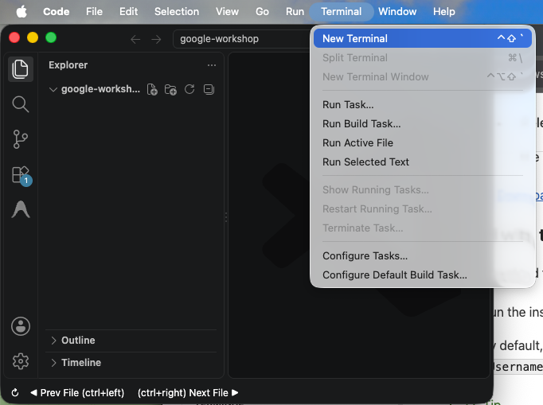

3. Run the following commands to scaffold the project and install all required dependencies:

```bash
# 1. Scaffold Next.js App Router with TypeScript and Tailwind CSS (single line works across Windows & Mac)
npx create-next-app@latest nus-digital-twin --typescript --tailwind --no-eslint --app --src-dir=false --import-alias="@/*" --use-npm --yes

# 2. Step into the created project directory
cd nus-digital-twin

# 3. Install geospatial, 3D math, icon, and utility dependencies
npm install maplibre-gl three @types/three lucide-react dotenv
npm install -D tsx @types/node
```

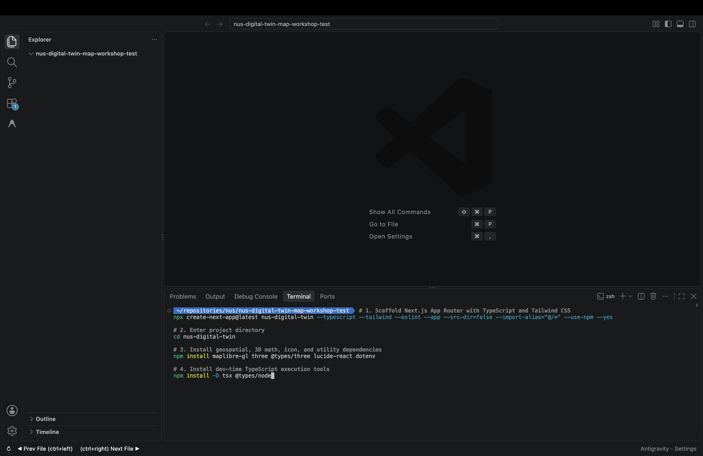

> [!TIP]
> **Key Libraries Explained:**
> - **`maplibre-gl`**: The open-source, community-led WebGL vector mapping engine fork of Mapbox GL. Delivers 60 FPS 3D map rendering, pitch, bearing, and native 3D `fill-extrusion` layers with zero proprietary license keys.
> - **`three` & `@types/three`**: High-performance JavaScript 3D engine used for custom 3D mesh rendering, lighting, materials, and Mercator coordinate transformations.
> - **`lucide-react`**: Crisp, accessible vector icons for the digital twin HUD and analytics charts.
> - **`tsx`**: TypeScript Execute — runs Node.js TypeScript scripts directly for instant verification without compiling.

---

### 3. Create Environment Configuration (`.env.local`)
1. In the VS Code file explorer sidebar, right-click on the `nus-digital-twin` folder and select **New File**.

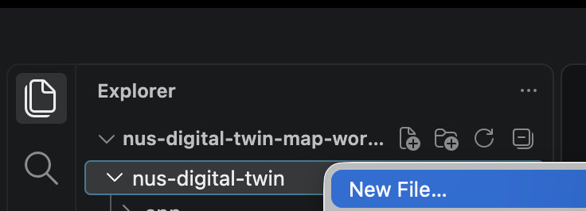

2. Name the new file `.env.local`.

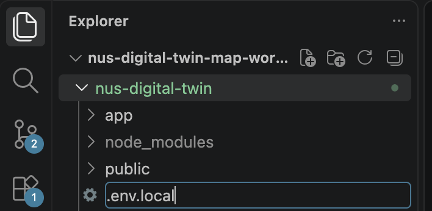

3. Add the following university API configuration:

```env
# NUS Live Transit Proxy API Endpoint (GCP Cloud Run - Free, open CORS, zero API keys)
NUS_TRANSIT_API="https://nus-transit-cache-429047621215.asia-southeast1.run.app"

# NUS Digital Twin Public API Endpoint
NUS_DIGITAL_TWIN_API="https://www.nus-digital-twin.com/api/v1/buildings"
```

Save the file using `Ctrl+S` (Windows) or `Cmd+S` (Mac).

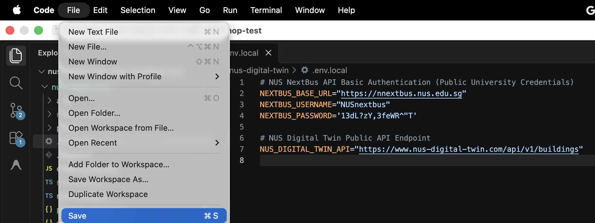

> [!NOTE]
> **Cloud Run Transit Proxy Architecture:**
> The live transit proxy runs on **Google Cloud Run** in `asia-southeast1`. It consumes upstream university transit feeds, caches payloads in-memory, derives real-time **estimated** vehicle positions bounded by stop-to-stop segments (`errorBoundM`), and serves all 100 workshop students with zero API keys and 3–5 ms latency.

---

### 4. Establish Antigravity Rules (`.agents/rules/workspace.md`)
Antigravity uses workspace rules inside `.agents/rules/` to ground its code generator on project-specific architectural decisions, preventing hallucinated packages or conflicting GIS conventions.

1. In the VS Code file explorer sidebar, select the `nus-digital-twin` folder and click the **New File** icon (or right-click `nus-digital-twin` > **New File**).
2. In the filename input box, type the nested path:
```text
.agents/rules/workspace.md
```
and press `Enter`. *(VS Code automatically generates both the `.agents` and `rules` folders simultaneously on both Windows and Mac).*

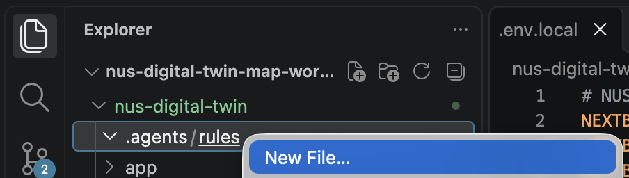

3. Double-click `workspace.md` to open it, paste the following rules into the editor, and save using `Ctrl+S` (Windows) or `Cmd+S` (Mac):

```markdown
# NUS 3D Digital Twin & Transit Tracker Rules

## Technology Stack & Architectural Conventions
- Framework: Next.js 14/15 App Router with TypeScript and Tailwind CSS.
- Map Engine: MapLibre GL JS (`maplibre-gl`). Always import `maplibre-gl/dist/maplibre-gl.css`.
- Basemap: OpenFreeMap Dark Mode vector style (`https://tiles.openfreemap.org/styles/dark`). 100% free, open CORS, zero API keys, zero rate limits, and zero watermarks. Do NOT use Carto or Mapbox tile URLs.
- 3D Rendering: Three.js (`three`) for custom 3D vehicle models, lighting, and spatial calculations.

## Client-Side Isolation & WebGL Zero-SSR Rule
- Mandatory Client-Only Map Import: MapLibre GL and Three.js access browser-only globals (`window`, `document`, `WebGLRenderingContext`). In `app/page.tsx`, you MUST import `MapCanvas` exclusively via Next.js dynamic client import with `{ ssr: false }`:
  `const MapCanvas = dynamic(() => import('@/components/MapCanvas'), { ssr: false });`
  NEVER import `maplibre-gl` or Three.js in any server component or code evaluated during server-side rendering.

## Payload Size & Data Ingestion Hygiene (< 128 kB)
- Client-Side Data Fetching: `app/page.tsx` must be a client component (`'use client'`). Do NOT fetch buildings on the server during page SSR. Fetch buildings (`/api/buildings`) and live transit (`/api/transit/buses`) inside `useEffect()` on the client side. This prevents serializing 900+ kB of campus GeoJSON into initial server HTML props and prevents Next.js `large-page-data` warnings.
- Route Handler Payload Pruning: In `/api/buildings`, omit raw polygon `footprint` coordinate arrays from the `buildings` array (since footprints are already in `buildingsGeoJson`), but preserve the full nested `eui: { annualTotal, monthlyBreakdown }` object on every building record so client components (`app/page.tsx`, `CampusEnergyChart`, `BuildingEnergyModal`) never fail when reading `.annualTotal` or `.monthlyBreakdown`.

## Geospatial Anchors & NUS Campus Coordinates
- Kent Ridge Campus Center: `[103.7745, 1.2970]` (Longitude, Latitude).
- Campus Bounding Box: `[103.7650, 1.2900, 103.7850, 1.3100]`.
- Default Camera: Pitch `60`, Bearing `-20`, Zoom `16.2`.
- Key Landmark Coordinates:
  - University Town (UTown): `[103.7738, 1.3040]`, Pitch: 60, Bearing: 45
  - School of Computing (COM3): `[103.7745, 1.2944]`, Pitch: 65, Bearing: -30
  - Central Library (CLB): `[103.7725, 1.2966]`, Pitch: 55, Bearing: 10
  - Kent Ridge MRT Station: `[103.7844, 1.2932]`, Pitch: 60, Bearing: -60

## API Contracts & Data Integration
1. NUS Digital Twin API: `https://www.nus-digital-twin.com/api/v1/buildings`
   - Upstream Response Schema: Returns a JSON array of 260 records containing ONLY `{ elementId, name, address, postal, latitude, longitude }`.
   - Procedural Enrichment in `lib/digitaltwin.ts`: Because upstream only provides point coordinates, `lib/digitaltwin.ts` MUST deterministically derive `height` (18m–48m), `floorCount` (4–12), `category` (`academic` | `residential` | `recreation` | `admin`), a ~36m×36m square GeoJSON polygon footprint centered on `[longitude, latitude]`, and a nested `eui: { annualTotal, monthlyBreakdown }` object (`cooling` ~55%, `equipment` ~30%, `lighting` ~15% in kWh/m²).
2. NUS Live Transit Proxy API (GCP Cloud Run): `https://nus-transit-cache-429047621215.asia-southeast1.run.app`
   - Live Proxy Base URL: `https://nus-transit-cache-429047621215.asia-southeast1.run.app`
   - Endpoints:
     - `/api/transit/buses`: Returns `{ asOf, upstreamLastUpdated, stale, estimated: true, buses: [...] }`. Each bus item has `{ id, route, plate, tripStart, status: 'IN_SERVICE' | 'AT_TERMINAL', lat, lng, bearing, speedKmh, arcM, routeLengthM, prevStop, anchorStop, anchorEtaMin, segmentFraction, errorBoundM, occupancy: { ridership, capacity } }`. Positions are rough approximations derived from per-stop ETAs (no public GPS feed exists). UI MUST label positions as *estimated* and display `errorBoundM` on hover/inspector.
     - `/api/transit/stops`: GeoJSON `FeatureCollection` of 33 `Point` features (`coordinates: [lng, lat]`) with `properties: { name, caption, LongName, ShortName, latitude, longitude }` (where `name` is the stop code, e.g. `"UTOWN"`).
     - `/api/transit/routes`: GeoJSON `FeatureCollection` of 8 `LineString` features with `properties: { route, length_m, closed, stops: Array<{ code, arc_m, seq }> }`. Map route colors on the client/backend (e.g. A1 `#EF4444`, A2 `#F59E0B`, D1 `#3B82F6`, D2 `#10B981`, K `#8B5CF6`, L `#EC4899`, E `#14B8A6`, BTC `#F97316`).
     - `/api/stop/:code`: Cached raw upstream timings for individual stops.
   - Off-Service Handling: Outside operating hours (07:00–23:00 SGT) or when `buses` array is empty, display scheduled operating resumption notices. Do not run synthetic fake wandering simulations.

## 3D Rendering & WebGL Conventions
- 3D Building Extrusions (`campus-3d-buildings`): Extruded physical footprints based on building height (18m–48m), colored by category (#38bdf8 academic, #c084fc residential, #34d399 recreation, #fbbf24 admin).
- 3D Energy Pillars (`campus-energy-pillars`): Concentrated 14m x 14m core polygons rising vertically from building rooftops (`fill-extrusion-base = height`, `fill-extrusion-height = height + (eui * 0.75)`, where the GeoJSON feature property `eui` is set to the numeric `building.eui.annualTotal`). Color dynamically using MapLibre `step` expression:
  - Efficient (< 160 kWh/m²): Green `#10B981`
  - Moderate (160–200 kWh/m²): Yellow `#F59E0B`
  - Energy Intensive (> 200 kWh/m²): Red `#EF4444`
- Revised 3D Bus Renderer (`nus-shuttle-bus-3d`): Three.js custom layer registered strictly *after* route polylines (layer ordering: roads -> routes -> 3D buses). Self-illuminating materials (vibrant orange roof `#FF7200`, crisp white chassis, warm white glowing headlights, taillights, rubber wheels) with 2.5x scale factor. Bus markers must indicate *Estimated Position* and show `errorBoundM` (segment bounds) on tooltip/inspector.
- Three.js Local Campus Matrix Anchor: In `lib/threeBusLayer.ts`, extract the camera projection matrix from `options?.defaultProjectionData?.mainMatrix` (or `options` if passed as a `Float64Array`) to obtain MapLibre's Mercator matrix. Anchor it to Kent Ridge Center `[103.7745, 1.2970]` using double-precision matrix multiplication (`camera.projectionMatrix = m.multiply(l)`, where `l` translates to the campus origin and scales with `meterInMercatorCoordinateUnits()`). Position each active bus in local meters `(dx, dy, dz)` relative to Kent Ridge Center so WebGL 32-bit float shaders render crisp, full-sized 3D vehicles without precision loss or depth clipping.
- MapLibre Async Data Synchronization: `components/MapCanvas.tsx` must store incoming `activeBuses`, `buildingsGeoJson`, and `stopsAndRoutesGeoJson` in `useRef`s or sync them both on `map.on('load')` and inside update effects. If `map.isStyleLoaded()` is false when new data arrives, defer source updates until the `load` or `styledata` event so asynchronously fetched transit data is never dropped.
- Dark Basemap Specification: Set `style: 'https://tiles.openfreemap.org/styles/dark'` in `components/MapCanvas.tsx`. OpenFreeMap provides high-contrast dark vector tiles (PBF) with sharp typography, open CORS, zero API keys, and zero watermarks.
- Campus Energy Efficiency Bar Chart: Sorts and displays buildings ranked by efficiency (lowest EUI = rank #1) with click-to-fly 3D camera navigation.
- Building Energy Inspector HUD: Floating glassmorphic sheet showing 12-month energy profiles when a building or pillar is clicked.
```

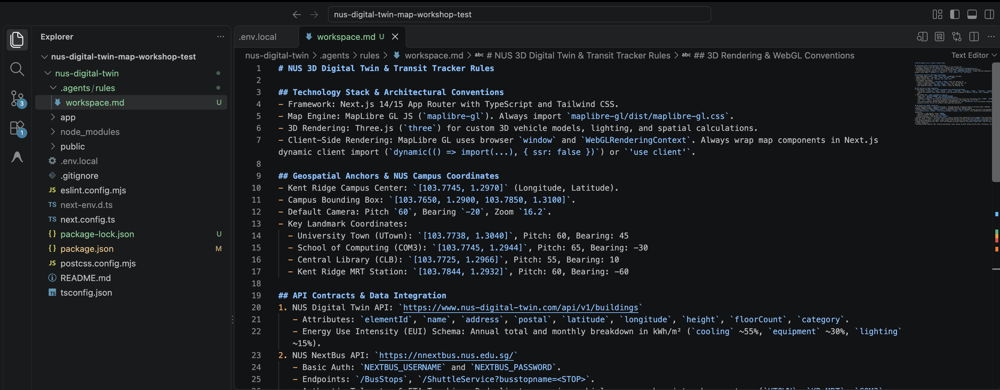

---

## Phase 1: Architecture Blueprint & Planning Mode with `/plan`
Duration: 0:10:00

Before generating code, professional developers review an implementation plan to verify architecture, module boundaries, and interfaces.

In Antigravity, **Planning Mode** (`/plan`) reads your project context and `.agents/rules/workspace.md` to generate a structured `implementation_plan.md` artifact detailing every file, API wrapper, 3D layer, and verification test before executing any changes.

### 🤖 The Agentic Prompt (Antigravity)
Open the **Antigravity Chat Panel** and enter the following prompt:

```text
/plan Generate a comprehensive implementation plan to build the NUS 3D Campus Digital Twin & Live Transit Tracker according to our .agents/rules/workspace.md.
Detail the file creations and verification steps for:
1. `lib/types.ts`: TypeScript definitions for `BuildingEnergy`, `CampusBuilding`, `ShuttleEta`, `BusStop`, `ActiveBus`, `CampusRoute`, and `TransitState`.
2. `lib/digitaltwin.ts`: API wrapper fetching building records from NUS Digital Twin API, procedurally deriving 3D heights (18m-48m), square GeoJSON polygon footprints, and 12-month EUI profiles (cooling 55%, equipment 30%, lighting 15%) with landmark fallbacks (COM3, UTown, CLB, S17).
3. `lib/transit.ts`: Transit client fetching real-time estimated bus positions, stop coordinates, and route polylines from the dedicated GCP Cloud Run Transit Proxy (`https://nus-transit-cache-429047621215.asia-southeast1.run.app`), rendering vehicle positions with error bounds (`errorBoundM`), and handling off-service hours (23:00-07:00 SGT) cleanly without synthetic simulations.
4. `app/api/buildings/route.ts`: Next.js App Router REST API endpoint returning `{ buildings, buildingsGeoJson }` (revalidate = 3600), omitting raw `footprint` arrays from `buildings` while preserving the full nested `eui: { annualTotal, monthlyBreakdown }` object on every building record.
5. `app/api/transit/buses/route.ts` & `app/api/transit/stops/route.ts`: Route handlers proxying live estimated shuttle telemetry (`cache: 'no-store'`) and static campus stops + route polylines GeoJSON from `NUS_TRANSIT_API`.
6. `components/MapCanvas.tsx`: High-performance client component ('use client'). Initialize MapLibre GL with OpenFreeMap Dark Mode vector style (`https://tiles.openfreemap.org/styles/dark`). Must synchronize dynamic GeoJSON sources (`campus-routes`, `campus-stops`, `campus-buildings`) and `ThreeBusLayer` active buses reliably using `useRef` / `map.on('load')` event listeners so asynchronously fetched transit data never drops due to style loading race conditions.
7. `lib/threeBusLayer.ts`: Three.js custom layer (`CustomLayerInterface`). In `render(gl, options)`, extract the projection matrix from `options?.defaultProjectionData?.mainMatrix` (or `options`), anchor the camera projection matrix to Kent Ridge center `[103.7745, 1.2970]` using MapLibre double-precision matrix multiplication (`m.multiply(l)`), and position buses in local relative meters `(dx, dy, 0.5)` with 2.5x scale factor and self-illuminating materials to prevent WebGL 32-bit float precision loss.
8. `components/BusTracker.tsx`: Live telemetry overlay auto-polling every 5 seconds with countdown timer and off-service badge.
9. `components/CampusEnergyChart.tsx`: Ranked campus energy efficiency bar chart with click-to-fly 3D camera navigation.
10. `components/BuildingEnergyModal.tsx`: Building inspector side sheet displaying 12-month energy breakdown bars.
11. `app/page.tsx`: Next.js client component ('use client'). Fetch `/api/buildings` and `/api/transit/buses` inside `useEffect()` on the client to avoid server-side SSR payload bloat (>128 kB). Dynamically import `MapCanvas` with `{ ssr: false }`.
```

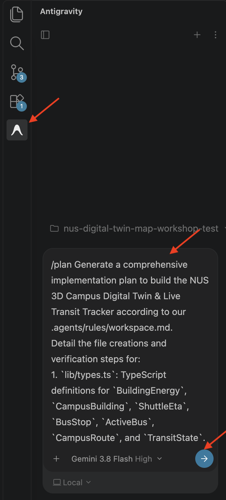

### Reviewing & Executing the Implementation Plan
Antigravity will create the `implementation_plan.md` artifact detailing each component's inputs, outputs, error handling strategies, and verification commands.

> [!IMPORTANT]
> **Implementation Plan Troubleshooting:**
> If the **Implementation Plan** artifact does not appear after submitting the `/plan` prompt, start a new conversation by clicking the **+** (New Chat) button at the top of the Antigravity chat panel and re-run the prompt.

1. In the Antigravity chat, click on **Implementation Plan** to open the plan viewer in your editor. Review the planned files and architecture.

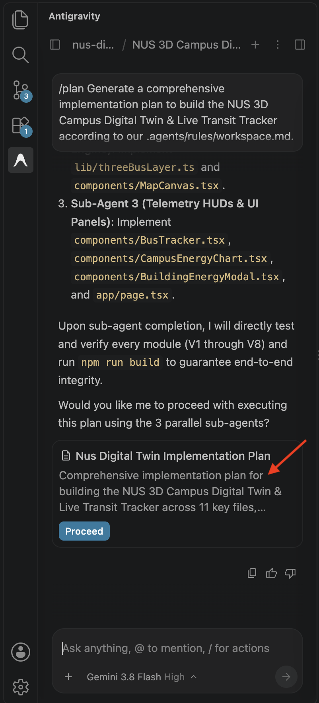

2. When satisfied, click **Proceed** in the top right of the plan viewer tab.

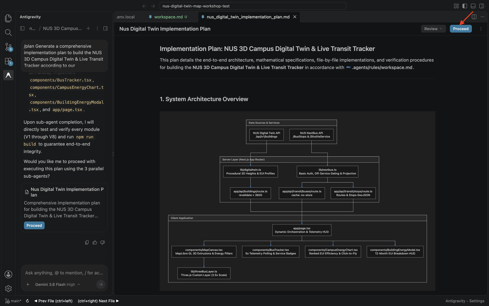

> [!TIP]
> **UI Guide**: In the implementation plan editor tab, click the **Proceed** button in the top right corner to start autonomous code generation.

3. Antigravity will autonomously generate all the project files according to the approved plan. In the following phases, we will inspect, test, and verify each layer of the application.
4. Once Antigravity finishes generating the files, click **Accept all** on the review bar to accept all changes into your workspace.

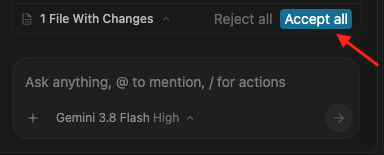

---

## Phase 2: Inspect Campus 3D & Telemetry Architecture
Duration: 0:08:00

In this phase, we inspect the core architectural layers generated by Antigravity and understand how 3D WebGL meshes, university telemetry, and geospatial projections interconnect.

### 🔍 Generated Files Overview
Take a few moments to open and explore each file in VS Code to see how Antigravity structured the codebase:

* **`lib/types.ts`**: Defines strict TypeScript interfaces for building footprints (`CampusBuilding`), 12-month energy profiles (`BuildingEnergy`), shuttle telemetry (`ActiveBus`), bus stops (`BusStop`), and aggregated transit states (`TransitState`).
* **`lib/digitaltwin.ts`**: Fetches building coordinates from `https://www.nus-digital-twin.com/api/v1/buildings`, augmenting each record with procedural 3D heights (18m–48m), square GeoJSON polygon footprints, and tropical EUI breakdowns (cooling ~55%, equipment ~30%, lighting ~15%).
* **`lib/transit.ts`**: Connects to the **NUS Live Transit Proxy** on GCP Cloud Run (`https://nus-transit-cache-429047621215.asia-southeast1.run.app`). It consumes real-time estimated bus positions with error bounds (`errorBoundM`), stop coordinates, and route polylines, handling off-service hours (23:00–07:00 SGT) cleanly without fake wandering simulations.
* **`lib/threeBusLayer.ts`**: Implements a MapLibre `CustomLayerInterface` named `nus-shuttle-bus-3d`. It uses Three.js to render 3D shuttle bus models with self-illuminating materials (vibrant orange roof `#FF7200`, white chassis, glowing LED headlights) and scales them by `2.5x` in Mercator space so they are unmistakably visible across campus roads.
* **`components/MapCanvas.tsx`**: Renders the 3D MapLibre canvas with OpenFreeMap Dark Mode vector tiles (`https://tiles.openfreemap.org/styles/dark`) and two synchronized `fill-extrusion` layers:
  1. `campus-3d-buildings`: Base physical footprints extruded to real building heights.
  2. `campus-energy-pillars`: 14m x 14m core rooftop pillars rising proportionally to EUI (`height + eui * 0.75`), styled dynamically with MapLibre's `step` expression (Green `<160`, Yellow `160-200`, Red `>200`).

> [!TIP]
> **Explore the WebGL Render Loop**: Open `lib/threeBusLayer.ts` in VS Code. Look at how `coord.meterInMercatorCoordinateUnits() * 2.5` scales the Three.js mesh and how `map.triggerRepaint()` drives the WebGL render loop!

---

## Phase 3: Launch & Test the 3D Digital Twin
Duration: 0:12:00

Now let's launch our local Next.js development server and interact with our live 3D campus twin.

### 1. Start the Development Server
In your VS Code terminal, ensure you are inside the `nus-digital-twin` directory, then start the development server:

```bash
npm run dev
```

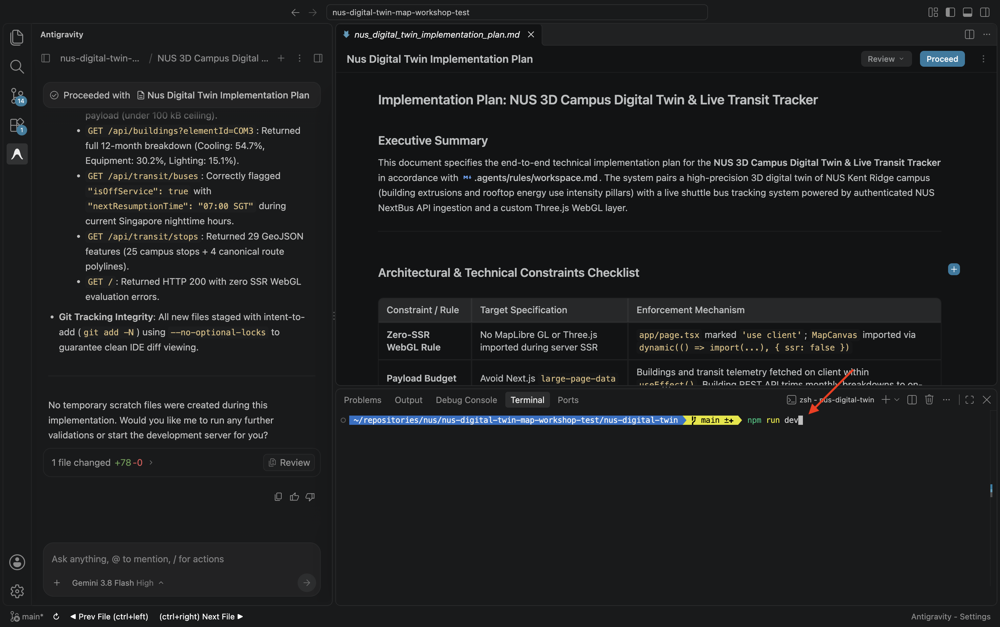

> [!WARNING]
> **Terminal Directory Troubleshooting:**
> - **`ENOENT: Could not read package.json`**: Your terminal is at the workspace root instead of the project directory. Run `cd nus-digital-twin` first, then run `npm run dev`.
> - **`cd: no such file or directory / Cannot find path`**: Your active terminal is already inside `nus-digital-twin`. Simply run `npm run dev` directly without `cd`.

### 2. Explore the Digital Twin in Your Browser
Open `http://localhost:3000` in Google Chrome:

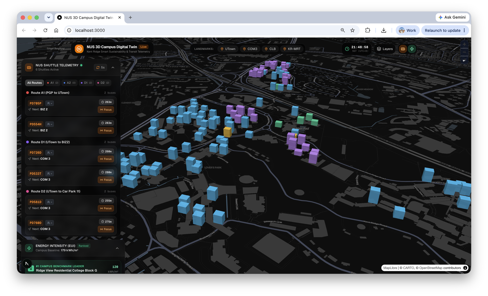

1. **3D Camera & Landmark Navigation**:
   * Observe the dark-mode OpenStreetMap canvas tilted at a 60-degree pitch with smooth 3D perspective.
   * Click the quick navigation buttons in the top-left toolbar (**University Town**, **Computing (COM3)**, **Central Library**, **Kent Ridge MRT**) to experience smooth fly-to camera transitions.
2. **Vertical 3D Energy Pillars**:
   * Look across campus rooftops at the vertical 3D Energy Pillars shooting into the sky:
     * **Stephen Riady Centre (UTown)**: Emerald green pillar (efficient 148 kWh/m²).
     * **Central Library (CLB)**: Amber yellow pillar (moderate 172 kWh/m²).
     * **School of Computing (COM3)**: Towering red pillar (energy-intensive 215 kWh/m²).
3. **Live Campus Transit HUD**:
   * Look at the top-right telemetry pill. Notice the 5-second countdown timer polling `/api/transit/buses`.
   * During daytime operations, active shuttle buses glide along routes with correct headings. Markers indicate **Estimated Position** and display the segment error bound (e.g. `±415m`) on hover/inspector.
   * During late-night hours (23:00–07:00 SGT), notice the sleek `Services Off-Peak (07:00 Resumption)` badge.
4. **Interactive Campus Energy Efficiency Ranking Bar Chart**:
   * Look at the bottom-right analytics card ranking facilities from most efficient (#1) to least efficient.
   * **Click any building bar** (e.g. Stephen Riady Centre or COM3):
     1. The camera glides across campus and centers on that building with high pitch (65°) and zoom (17.2).
     2. The **Building Energy Inspector** sheet slides into view with detailed cooling, equipment, and lighting distributions and a 12-month consumption trend!

---

## Phase 4: Supercharge Your Agent with Skills & `/grill-me` Design Interview
Duration: 0:12:00

Now that your functional 3D digital twin is running, let's elevate its visual presentation and command center aesthetics from a functional demo to an award-winning geospatial dashboard.

In this phase, you will learn two advanced Antigravity capabilities:
1. **Agent Skills**: Extending Antigravity's capabilities with specialized design system skills.
2. **Interactive Design Discovery (`/grill-me`)**: Letting Antigravity interview you to capture your creative intent before touching code.

### 1. What Are Agent Skills?
In modern agentic AI, **Skills** are modular packages containing specialized instructions, industry heuristics, and design guidelines that extend your agent's problem-solving toolkit. 

Antigravity automatically discovers and loads skills located in your project's `.agents/skills/` directory.

### 2. Install the Frontend Taste Skill
We will install [`taste-skill`](https://github.com/Leonxlnx/taste-skill) — an open-source collection of design intelligence skills (Minimalist UI, High-End Visual Design, Industrial Brutalism, and Brand Kit).

1. In your VS Code terminal panel, click the **+** icon to open a new terminal tab.

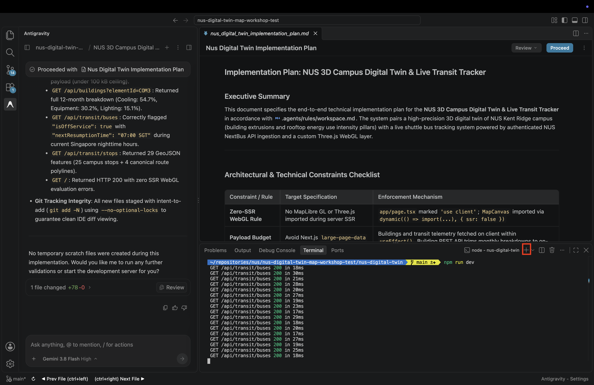

2. Run the following command:

```bash
npx skills add Leonxlnx/taste-skill -y
```

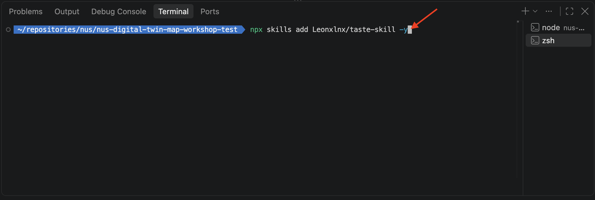

> [!NOTE]
> **Why `-y`?**: The `-y` flag skips interactive prompts and automatically selects all design skills for Antigravity, copying them directly into `.agents/skills/`.

---

### 3. Trigger the Interactive Design Interview (`/grill-me`)
Instead of trying to write a 500-word prompt detailing exact hex codes and CSS animations, use Antigravity's built-in `/grill-me` slash command. This instructs the agent to ask *you* clarifying questions to uncover your preferred visual aesthetic.

Open the **Antigravity Chat Panel** and prompt:

```text
/grill-me I want to redesign our NUS 3D Campus Digital Twin command center (`app/page.tsx`, `components/MapCanvas.tsx`, and `components/CampusEnergyChart.tsx`) using our newly installed taste skills. 
Grill me with questions about my preferred visual aesthetics (e.g., Cyberpunk Neon, Minimalist Dark Architecture, or High-Contrast Tactical Command Center), HUD density, 3D energy pillar color palettes, camera animation speed, and telemetry badge styling. Once I confirm my decisions, immediately make the code edits.
```

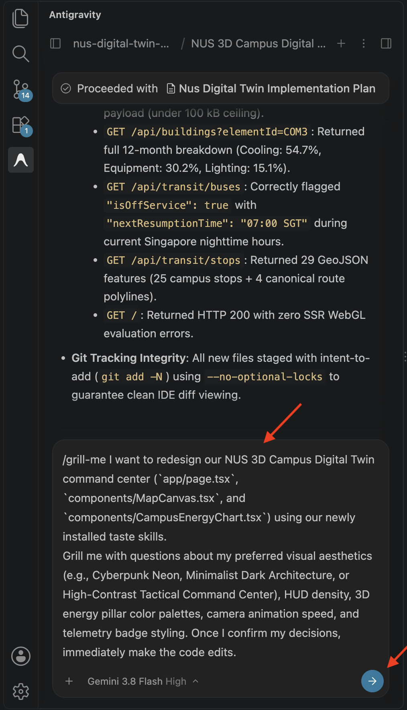

### 4. Answer Antigravity's Questions & Apply the Redesign
1. Antigravity will interview you with interactive multiple-choice questions directly in the chat panel (e.g. Visual Theme, Glassmorphism HUD density, Energy Pillar color ramp, Landmark button styling).
2. Select your preferred options (or type custom specifications into the write-in box), then click **Continue**.

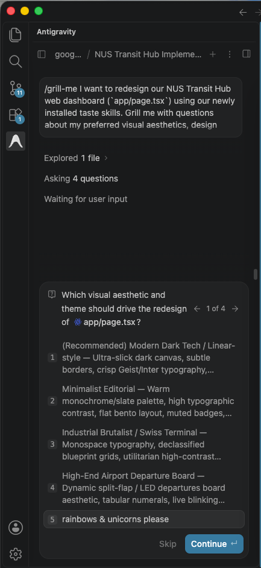

> [!TIP]
> **UI Guide**: Antigravity presents interactive multiple-choice cards directly in the chat panel to resolve creative and architectural decisions before writing code.

3. Antigravity will synthesize your preferences into an updated implementation plan. Click **Proceed**.
4. Antigravity will refactor `app/page.tsx`, `components/MapCanvas.tsx`, and `components/CampusEnergyChart.tsx` according to your aesthetic choices. Click **Accept all** when prompted.


5. Return to `http://localhost:3000` to witness your custom-tailored digital twin command center!

---

## Phase 5 (Optional Challenge): Deploy to Vercel
Duration: 0:05:00

Now that your 3D digital twin is running locally, your challenge is to transition your system to production by deploying to **Vercel Serverless Edge**.

Create your free Hobby account from [vercel.com/signup](https://vercel.com/signup) for Phase 5 (optional challenge).

### 1. What is Vercel?
**Vercel** is the native cloud deployment platform created by the authors of Next.js.
* **Serverless Next.js App Router**: API routes defined in `app/api/...` run as serverless micro-functions with zero VM management.
* **Instant Global Edge Routing**: Every deployment receives a free production URL (e.g., `https://nus-digital-twin.vercel.app`) with automatic SSL and CDN caching.

### 2. Deploying via Vercel CLI
1. Log in to Vercel in your VS Code terminal:
   ```bash
   npx vercel login
   ```
   *(Authorize the CLI in your browser when prompted).*

2. Deploy the application to production:
   ```bash
   npx vercel --prod
   ```
   *(Press Enter to accept standard defaults).*

3. Configure Environment Variables in the Vercel Dashboard:
   * Go to [vercel.com/dashboard](https://vercel.com/dashboard) and open your `nus-digital-twin` project.
   * Navigate to **Settings > Environment Variables**.
   * Add each variable with the target environment set to `Production`:

| Variable Key | Type | Production Value |
| :--- | :--- | :--- |
| `NUS_TRANSIT_API` | Plaintext | `https://nus-transit-cache-429047621215.asia-southeast1.run.app` |
| `NUS_DIGITAL_TWIN_API` | Plaintext | `https://www.nus-digital-twin.com/api/v1/buildings` |

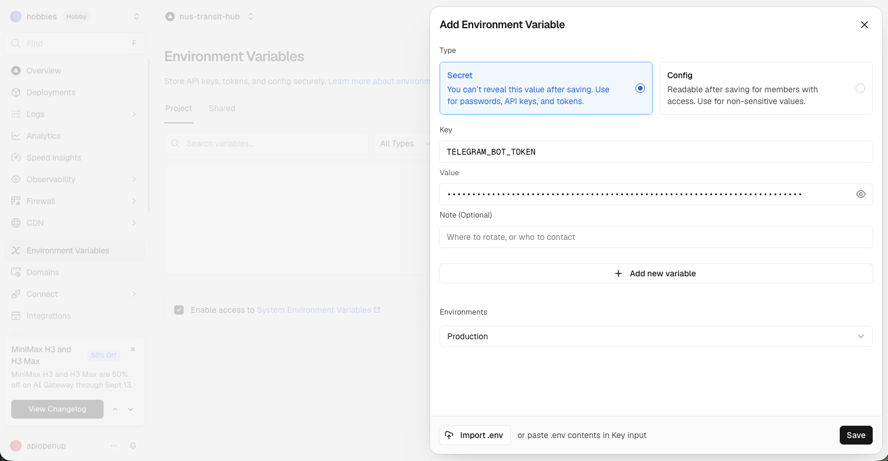

4. Redeploy to apply the environment variables:
   * In your Vercel project dashboard, navigate to the **Deployments** tab, click the three-dots menu (`...`) on your latest deployment, and select **Redeploy**.
   * Alternatively, trigger a redeployment from your terminal:
   ```bash
   npx vercel --prod --yes
   ```

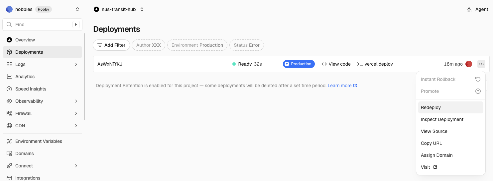

5. Open your live Vercel production URL on your laptop or smartphone!

---

## Summary & Antigravity Slash Commands Reference
Duration: 0:03:00

Congratulations! You have designed, planned, verified, and deployed a **3D NUS Campus Digital Twin & Live Transit Tracker** using **Spec-Driven Development** in **Google Antigravity**.

### What You Built:
* **Spec-Driven Development (SDD)**: Anchored architectural standards, geospatial coordinates, and API contracts in `.agents/rules/workspace.md`.
* **Planning Mode (`/plan`)**: Built an entire full-stack 3D digital twin from specifications in a single agentic plan.
* **Interactive Design Discovery (`/grill-me`)**: Installed `taste-skill` and conducted an interactive design interview to tailor the visual aesthetic of your command center.
* **3D OpenStreetMap Engine**: Rendered vector tiles, dynamic camera pitch and bearing controls, and physical 3D building extrusions with **MapLibre GL JS**.
* **3D Energy Pillars**: Visualized campus energy intensity with vertical 3D extrusions rising from building rooftops, color-coded Green/Yellow/Red.
* **Revised 3D Shuttle Bus Renderer**: Implemented Three.js 3D buses rendered strictly above route polylines, utilizing self-illuminating materials and a 2.5x scale factor.
* **Interactive Campus Energy Efficiency Bar Chart**: Ranked campus facilities by energy performance with interactive click-to-fly camera transitions.

---

### Antigravity Slash Commands Cheat Sheet
Antigravity provides built-in slash commands in the chat panel to supercharge developer workflows:

| Slash Command | Purpose | When to Use |
| :--- | :--- | :--- |
| **`/plan`** | **Architecture Blueprinting** | Complex tasks requiring step-by-step architectural review and approval before writing code. |
| **`/grill-me`** | **Interactive Interview** | Exploring design decisions, UX preferences, and ambiguous requirements before implementation. |
| **`/browser`** | **Web Automation & QA** | Inspecting live localhost apps, taking screenshots, and verifying visual rendering. |
| **`/schedule`** | **Timers & Recurring Jobs** | Setting background polling, heartbeat timers, or scheduled task notifications. |
| **`/goal`** | **Autonomous Goal Execution** | Extra-thorough, long-running agentic tasks that shouldn't stop until complete. |
| **`/learn`** | **Knowledge Persistence** | Teaching the agent project-specific rules, domain quirks, or setup instructions for future tasks. |

---

### What's Next?
* **Solar PV Potential**: Add rooftop solar irradiance estimation to the building inspector using Singapore BCA solar data.
* **Pedestrian Walkways**: Ingest sheltered walkway graphs from OpenStreetMap to provide rain-free campus routing.
* **IoT Sensor Feeds**: Connect live indoor temperature and occupancy sensors to individual floors in COM3 and UTown!
